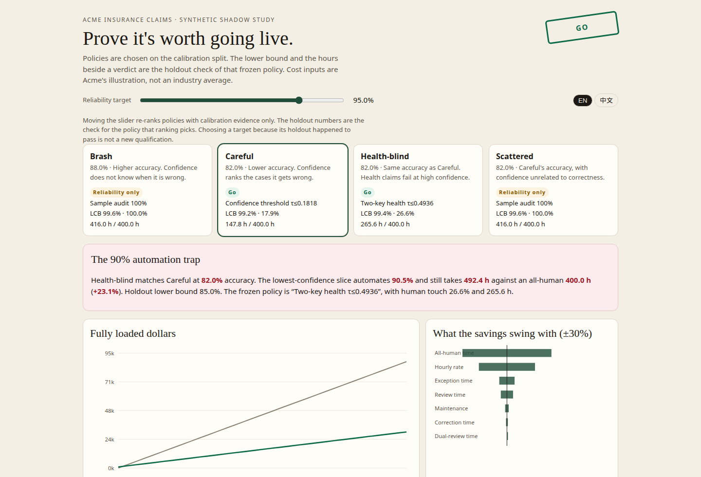
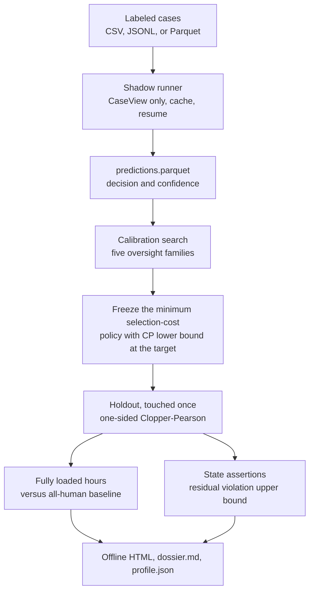

# Breakeven

**Prove it's worth going live.**

**上线前先算清账。**

Shadow-replay labeled cases, freeze the cheapest oversight policy whose calibration evidence clears a reliability target, and check that policy once on held-out cases. The dossier prices every remaining human hour against an all-human baseline. Cost parameters come from the customer. This repository does not claim an industry-average ROI.

用客户自己的历史案例做影子回放：在调参集上冻结「既满足可靠性目标、又最省钱」的人工监督策略，再在留出集上只检验这一次。报告按全口径人工工时，对照全人工基线算盈亏平衡。成本参数由客户填写。本仓库不宣称任何行业平均回报率。



[Slider and 中文 toggle](docs/demo.gif) · [Open the offline dossier](docs/acme-report.html) · [Measured profile](docs/measured-profile.json)

The screenshot and GIF are the Acme report from `breakeven demo --cases 2000 --seed 7 --target 0.95 --reps 1000 --boot 400`. Dragging the reliability target re-ranks policies using calibration metrics only. The Chinese toggle is the same page.

截图和 GIF 来自上述命令生成的 Acme 报告。拖动可靠性目标时，排序只用调参集指标。中文开关是同一页的译文。

## Why / 为什么做

Forward-deployed work is being sold as the way to prove that an AI deployment pays.

- On 30 June 2026 AWS committed [$1 billion](https://www.aboutamazon.com/news/aws/aws-1-billion-forward-deployed-ai-engineers) to a Forward Deployed Engineering organization ([Reuters](https://www.reuters.com/business/retail-consumer/amazons-aws-commits-1-billion-toward-new-unit-embedded-ai-engineers-2026-06-30/)). [CNBC](https://www.cnbc.com/2026/06/30/aws-amazon-ai-forward-deployed-engineers.html) described the starting embed as a pod of roughly five or six engineers. Reuters phrases the same announcement as “five to six pods” for 45-day periods; this README uses CNBC for the pod size and the AWS post plus Reuters for the dollar commitment.
- On 2 October 2026 Anthropic launched [Claude Frontier Academy](https://www.anthropic.com/news/claude-frontier-academy): a $100 million commitment to train 10,000 Frontier Deployed Engineers by the end of 2027. Residents start with a simulated enterprise deployment, then a residency.
- On 15 October 2026 [CNBC](https://www.cnbc.com/2026/10/15/aws-anthropic-racing-to-deploy-army-of-specialized-ai-engineers.html) framed that hiring as a race to prove the AI spend pays off.

The measurement problem those teams walk into is already in the papers, and the numbers below are **theirs**, not this tool’s:

- [READY](https://arxiv.org/abs/2609.02095) (arXiv:2609.02095) qualifies a frozen oversight policy on held-out cases. In its 750-case clinical audit, two systems 0.3 points apart in autonomous accuracy (72.8% vs 72.5%) needed 39.2% vs 29.6% human review to qualify at a 76% reliability target, under an assumed human-review accuracy of 0.90.
- [The Last Human Gate](https://arxiv.org/abs/2609.29345) (arXiv:2609.29345) counts residual human work after exceptions, verification, correction, and maintenance. Its own illustration: if the remaining 20% of cases take twice the average time, they already hold 40% of baseline labor; a further 50% handling penalty makes that slice 60%. Automating most cases can increase total labor. The paper does not publish a single “automation raises labor by X%” result, and this README does not invent one.
- [FDE-Gym](https://arxiv.org/abs/2610.22350) (arXiv:2610.22350): best evaluated configuration resolves 14 of 95 tasks. [FDE-Bench](https://arxiv.org/abs/2610.14539) (arXiv:2610.14539): best delivery success rate 6.12%. [LatentRiskBench](https://arxiv.org/abs/2610.17685) (arXiv:2610.17685): an action-level check catches 0.09 of state-dependent violations; a state-level check catches 0.96.

Nearby open source is roadmaps and templates, for example [Awesome-FDE-Roadmap](https://github.com/pierpaolo28/Awesome-FDE-Roadmap) and Microsoft’s [ValueLens](https://github.com/microsoft/ValueLens-for-Microsoft-Copilot) Power BI workbook. Star counts move; this README does not quote them. Breakeven is a qualification procedure: a statistical lower bound, a frozen policy, and a fully loaded cost sheet.

驻场工程正在被当作「证明这笔 AI 支出划算」的办法来卖。AWS 于 2026-06-30 承诺投入 [10 亿美元](https://www.aboutamazon.com/news/aws/aws-1-billion-forward-deployed-ai-engineers)组建前向部署工程组织（[Reuters](https://www.reuters.com/business/retail-consumer/amazons-aws-commits-1-billion-toward-new-unit-embedded-ai-engineers-2026-06-30/)）。[CNBC](https://www.cnbc.com/2026/06/30/aws-amazon-ai-forward-deployed-engineers.html) 把起步编制写成大约五到六人的小组；Reuters 对同一则公告的表述是「五到六个小组、每次约 45 天」。小组规模以 CNBC 为准，金额以 AWS 博文和 Reuters 为准。Anthropic 于 2026-10-02 发布 [Claude Frontier Academy](https://www.anthropic.com/news/claude-frontier-academy)，承诺 1 亿美元，目标是到 2027 年底培养 10,000 名 Frontier Deployed Engineer，课程从一次模拟企业部署开始。2026-10-15 的 [CNBC](https://www.cnbc.com/2026/10/15/aws-anthropic-racing-to-deploy-army-of-specialized-ai-engineers.html) 把这轮招聘概括成一场「证明回报」的竞赛。

上面三篇部署论文里的数字是**论文自己的**，不是本工具跑出来的。READY 在 750 条临床审计上观察到：自主准确率只差 0.3 个点（72.8% 与 72.5%）的两个系统，要在人工复核准确率假定为 0.90 时达到 76% 的可靠性目标，分别需要 39.2% 和 29.6% 的人工复核。Last Human Gate 把异常、核验、纠错和维护都算进剩余人工；它举的例子是，剩下 20% 的案子如果耗时是平均的两倍，就已经占掉基线工时的 40%，再加 50% 的接手惩罚则占到 60%。论文没有给出一个「自动化让人工增加 X%」的单一结论，这里也不编。FDE-Gym 最好的配置只解决 95 项里的 14 项；FDE-Bench 最高交付成功率 6.12%；LatentRiskBench 上，只看动作能查出 0.09 的状态相关违规，按状态查能查出 0.96。

相近的开源仓库是路线图和模板，例如 [Awesome-FDE-Roadmap](https://github.com/pierpaolo28/Awesome-FDE-Roadmap) 和微软的 [ValueLens](https://github.com/microsoft/ValueLens-for-Microsoft-Copilot)。星数会变，这里不引用。Breakeven 做的是上线资格：统计下界、冻结的策略、以及一张算全的成本表。

## 60-second start / 一分钟跑起来

Python 3.11 or newer. The demo is offline: synthetic claims, simulated agents, no API key.

需要 Python 3.11 及以上。演示完全离线：合成理赔、模拟代理、不需要 API key。

```bash
pip install -e ".[dev]"
breakeven demo
```

If the `breakeven` script is not on `PATH`, the same entry point is `python -m breakeven`. Defaults are 2,000 cases, seed 7, reliability target 0.95, 1,000 evaluation repetitions, 400 bootstrap draws. The command writes `breakeven-out/report.html` (open it in a browser; nothing is fetched), `dossier.md`, and `profile.json`.

如果 `breakeven` 不在 `PATH` 上，用 `python -m breakeven`。默认 2000 条案例、种子 7、可靠性目标 0.95、评测重复 1000 次、bootstrap 400 次。输出在 `breakeven-out/`：用浏览器打开 `report.html`（页面不访问网络），旁边有 `dossier.md` 和 `profile.json`。

```bash
breakeven init --dir acme
breakeven run --config acme/breakeven.yaml
breakeven qualify --config acme/breakeven.yaml
breakeven report --config acme/breakeven.yaml --open
breakeven simulate --reps 1000
```

`qualify` searches policies. `simulate` only checks the bound and the oracle gap; it does not call a model.

`qualify` 搜索监督策略。`simulate` 只检验统计界和与最优阈值的差距，不调用模型。

## What the Acme run decided / 这次 Acme 演算的结论

Every figure in this section is from [docs/measured-profile.json](docs/measured-profile.json), produced by:

本节每个数字都来自 [docs/measured-profile.json](docs/measured-profile.json)，命令是：

```bash
breakeven demo --cases 2000 --seed 7 --target 0.95 --reps 1000 --boot 400
```

Stratified 60/40 split by category: 1,200 calibration cases, 800 holdout. Target reliability 95%, one-sided 95% Clopper–Pearson. The illustrative Acme sheet (not a market rate): loaded wage $55/hour, all-human 0.20 h/case, review 0.25 h, exception 0.50 h, dual review 0.50 h, audit 0.20 h, correction of a shipped error 1.60 h, maintenance 16 h per 2,000-claim period, model cost $0, reviewer accuracy 1. All-human baseline: 400 hours, $22,000.

按类别分层 60/40：调参集 1200 条，留出集 800 条。可靠性目标 95%，单侧 95% Clopper–Pearson。下面的 Acme 成本表只是一份示例，不是市场价：全成本时薪 55 美元，全人工 0.20 小时/件，复核 0.25，异常 0.50，双人复核 0.50，抽检 0.20，漏检纠错 1.60，每 2000 件的维护 16 小时，模型成本 0，复核准确率 1。全人工基线 400 小时、22,000 美元。

| Agent | Accuracy | Verdict | Frozen policy | Holdout lower bound | Human touch | Hours vs 400 | Breakeven |
|---|---:|---|---|---:|---:|---:|---:|
| Careful | 82.0% (1,640/2,000) | Go | Confidence τ ≤ 0.1818 | 99.2% | 17.9% | 147.8 | 119 cases |
| Health-blind | 82.0% (1,640/2,000) | Go | Two-key on health, τ ≤ 0.4936 | 99.4% | 26.6% | 265.6 | 213 cases |
| Brash | 88.0% (1,760/2,000) | Reliability only | Sample audit 100% | 99.6% | 100% | 416.0 | none |
| Scattered | 82.0% (1,640/2,000) | Reliability only | Sample audit 100% | 99.6% | 100% | 416.0 | none |

| 代理 | 准确率 | 结论 | 冻结的策略 | 留出集下界 | 人工介入 | 工时（基线 400） | 盈亏平衡 |
|---|---:|---|---|---:|---:|---:|---:|
| 稳妥 Careful | 82.0%（1640/2000） | 可上线 | 置信度 τ ≤ 0.1818 | 99.2% | 17.9% | 147.8 | 119 件 |
| 健康险盲区 Health-blind | 82.0%（1640/2000） | 可上线 | 健康险双人复核，τ ≤ 0.4936 | 99.4% | 26.6% | 265.6 | 213 件 |
| 冒进 Brash | 88.0%（1760/2000） | 只够可靠 | 抽检 100% | 99.6% | 100% | 416.0 | 不会 |
| 散点 Scattered | 82.0%（1640/2000） | 只够可靠 | 抽检 100% | 99.6% | 100% | 416.0 | 不会 |

Careful’s holdout point reliability is 99.75% (798/800). Dollar savings $13,873.75; the bootstrap 5th–95th percentile is $12,931.88 to $14,796.03. Health-blind’s point reliability is 99.875% (799/800). Savings $7,390.63; bootstrap $6,055.16 to $8,849.16. Health claims are exactly 160/400 correct (accuracy 0.40) on the full book. Brash and Scattered both clear the reliability bar by reviewing every case, then cost $880 more than the all-human baseline (416 h vs 400 h, the 16 h of maintenance). Their bootstrap interval is that same −$880, because a 100% audit with a perfect reviewer has no sampling variation in shipped errors. Reviewing everyone can satisfy the reliability target and still not be a deployment.

稳妥在留出集上的点估计可靠性是 99.75%（798/800）。节省 13,873.75 美元；bootstrap 第 5 到第 95 百分位是 12,931.88 到 14,796.03 美元。健康险盲区的点估计是 99.875%（799/800），节省 7,390.63 美元，bootstrap 为 6,055.16 到 8,849.16 美元。全量健康险恰好 160/400 判对（准确率 0.40）。冒进和散点靠「每件都人工看」通过了可靠性，但比全人工基线多花 880 美元（416 小时对 400 小时，多出来的是 16 小时维护）。复核人员假定完美时，100% 抽检没有漏检的抽样波动，所以 bootstrap 区间就是这一个 −880 美元。把所有案子都交给人，可以满足可靠性，仍然不构成一次值得上线的部署。

### Same accuracy, opposite recommendation / 准确率相同，结论相反

Careful and Scattered are both at 82.0%. Careful goes live at 36.9% of baseline hours. Scattered does not pay. Brash is more accurate, at 88.0%, and also does not pay. Accuracy is the wrong headline.

稳妥和散点都是 82.0%。稳妥以基线工时的 36.9% 上线。散点不划算。冒进更准，88.0%，同样不划算。准确率不是该写进标题的那个数。

### The 90% automation trap / 自动化九成的陷阱

On Health-blind, the confidence-only rule whose calibration human-touch is closest to 10% freezes at τ ≤ 0.5679. On the holdout set that plan automates 90.5% of cases and projects **492.4 human hours against 400** (+23.1%). Point reliability is 87.1%, the lower bound is 85.0%, and the miss rate is 12.9%. It does not qualify. The policy that does qualify is the two-key rule above, at 26.6% human touch and 265.6 hours.

An early sketch of this demo used “+12%” as a picture of the trap. The measured increase on seed 7 is +23.1%. The report shows the measurement.

健康险盲区上，调参集人工介入最接近 10% 的那条纯置信度规则冻结在 τ ≤ 0.5679。留出集上它自动化了 90.5% 的案子，投影人工工时 **492.4，基线是 400（+23.1%）**。点估计可靠性 87.1%，下界 85.0%，漏检率 12.9%。它不合格。真正合格的是上面的双人复核规则：人工介入 26.6%，工时 265.6。

演示稿里曾经用「+12%」形容这个陷阱。种子 7 上测到的增幅是 +23.1%。报告写测量值。

## Architecture / 架构



Agents never see `decision_truth` or `fraud`. Nothing in the shadow run pays a claim or closes a file. The HTML file embeds its charts as SVG and a Vega-Lite spec; it does not load a CDN.

代理看不到 `decision_truth` 和 `fraud`。影子回放不会付款，也不会结案。HTML 把图嵌成 SVG，并附上 Vega-Lite 规格，不加载 CDN。

## Method / 方法

1. **Shadow replay.** Each case produces a decision and a confidence. The four Acme agents are simulated and fixed by the seed. `brash` is right on 88% of cases and its confidence does not know when it is wrong. `careful` is right on 82%, and its errors are exactly the lowest confidences. `health_blind` is also right on 82%, with health accuracy exactly 0.40 and those health errors sitting at high confidence. `scattered` matches Careful’s 82% with confidence unrelated to correctness. The spec asked for three personas. The fourth is the matched control the decision-flip needs: Health-blind still has a deployable two-key policy, so “same accuracy, opposite verdict” would be invisible without a confidence process that carries no rank information.
2. **Five policies, chosen on the calibration split only.** Autonomous; confidence threshold; proportional sample audit (stable per case via SHA-256); two-key review on a customer menu of high-risk categories and amount cutoffs; state-check, which routes asserted violations to a person. Thresholds are the tie boundaries of the calibration confidences, not a coarse grid. The high-risk menu (health, health+liability, liability; amount cutoffs 10k, 25k, 50k) is an input. Category accuracy on the calibration set is printed as a diagnosis. It is not mined into a new category after seeing the holdout.
3. **The gate is Clopper–Pearson.** One-sided lower endpoint, `Beta(k, n−k+1)` at α = 0.05. Wilson’s score lower bound is printed beside it and is not allowed to clear a policy. When reviewer accuracy is 1, escalations are observed successes and the gate is an ordinary binomial bound. When it is below 1, the bound follows the READY appendix construction: Clopper–Pearson on accepted cases only, plus the assumed review accuracy with no extra confidence. `a_h min` is the weakest constant review accuracy that still clears the target.
4. **Selection prices the miss upper bound.** Ranking policies on the observed miss count lets a lucky calibration sample under-review, which is expensive when a correction takes 1.60 h and a review takes 0.25 h. The ranking cost adds the gap between the observed miss count and its one-sided Clopper–Pearson upper bound. The hours reported on the holdout stay the point estimate.
5. **Holdout is touched once.** A go-live verdict needs all three: holdout lower bound at or above the target, point-estimate dollar savings above zero, and a bootstrap 5th percentile of dollar savings above zero. Statuses are `go`, `reliability_only`, `cost_uncertain`, `holdout_miss`, and `no_eligible_policy`. The HTML slider re-ranks with calibration metrics. Moving it after you have seen the holdout is not a new qualification.
6. **Fully loaded hours.** A case sits in one handling bucket. Exception time replaces standard review time. Shipped errors are autonomous misses plus expected reviewer mistakes.

```
H_agent = n_review·t_review + n_exception·t_exception + n_dual·t_dual
        + n_audit·t_audit + n_shipped·t_correction + maintenance
H_human = n·t_human + human_maintenance
```

Rates are estimated on the holdout and projected to the full period. Maintenance is fixed. Breakeven volume is `(maintenance − human_maintenance) × rate / (human variable $ − agent variable $)`, or none when the agent is not strictly cheaper per case.

7. **State assertions.** A small comparison language (`and` / `or` / `not`, comparisons, list membership). No calls and no attribute lookup, so an assertion file cannot execute code. The Acme file forbids paying an unapproved claim, paying a high-value claim straight from intake, and approving an incomplete file. Careful still ships 9 violations in 657 accepted holdout cases (rate 1.37%, one-sided upper bound 2.38%). Health-blind ships 5 of 587 (0.85%, upper bound 1.78%).

1. **影子回放。** 每条案例只产出决策和置信度。四个 Acme 代理由种子固定。`brash` 准确率 88%，置信度不知道自己何时错。`careful` 准确率 82%，错例恰好是置信度最低的那些。`health_blind` 也是 82%，健康险准确率恰好 0.40，而且这些错例置信度很高。`scattered` 同样 82%，置信度与对错无关。规格写了三种人设。第四个是「准确率相同、结论相反」所需要的对照：健康险盲区仍然有一条能上线的双人复核策略，如果没有一个完全不携带排序信息的置信度过程，这个对照就不存在。
2. **五种策略，只在调参集上选。** 完全自主；置信度阈值；按比例抽检（用 SHA-256 把抽中与否钉在案例上）；客户事先给定的高风险类别和金额阈值上的双人复核；状态检查，把断言违规转人工。阈值取调参集置信度的结界，不是粗网格。高风险菜单（健康险、健康险+责任险、责任险；金额 1 万、2.5 万、5 万）是输入。调参集上的分类准确率只作诊断，不会在看过留出集之后再长出一个新类别。
3. **门是 Clopper–Pearson。** 单侧下端点，α = 0.05 时的 `Beta(k, n−k+1)`。Wilson 分数下界印在旁边，不能用来放行。复核准确率为 1 时，升级人工的案子是观察到的成功，门就是普通二项下界。低于 1 时，沿用 READY 附录的构造：只对放行的案子做 Clopper–Pearson，复核准确率按假定值加进去，不再给它置信度。`a_h min` 是条件界仍能达到目标时，复核准确率可以低到什么程度。
4. **选型成本按漏检上界计价。** 用观察到的漏检数排名，会让一份碰巧很干净的调参样本少复核。纠错 1.60 小时、复核 0.25 小时时，这种少复核很贵。排名成本补上「观察到的漏检数」和「单侧 Clopper–Pearson 上界」之间的差额。留出集上报告的工时仍是点估计。
5. **留出集只碰一次。** 上线结论要同时满足三件：留出集下界不低于目标、点估计节省金额大于 0、节省金额的 bootstrap 第 5 百分位大于 0。状态有 `go`、`reliability_only`、`cost_uncertain`、`holdout_miss`、`no_eligible_policy`。网页滑块只用调参集指标重排。看过留出集再挪目标，不是一次新的资格认定。
6. **全口径工时。** 每条案例只进一个处理桶。异常工时替代普通复核，不叠加。漏检包括自主放行的错，以及复核人员按 `(1 − a_h)` 期望犯的错。

费率在留出集上估计，再投影到整个周期。维护是固定成本。盈亏平衡件数是 `(维护 − 全人工维护) × 时薪 / (全人工变动成本 − 代理变动成本)`。如果代理的单件变动成本并不更低，就没有平衡点。

7. **状态断言。** 一种很小的比较语言（`and` / `or` / `not`、比较、列表成员）。没有函数调用，也没有属性访问，断言文件不能执行代码。Acme 的断言禁止：未批准就付款、高额案件从受理直接付款、材料不全却批准。稳妥在 657 条放行的留出案例里仍有 9 条违规（1.37%，单侧上界 2.38%）。健康险盲区是 587 条里的 5 条（0.85%，上界 1.78%）。

## Bring your own cases / 接入你自己的案例

`breakeven init` writes `breakeven.yaml` and `assertions.yaml`. Point `dataset.path` at a CSV, JSONL, or Parquet file and remove `generator: acme` if you do not want the synthetic book. Required columns:

`breakeven init` 会写出 `breakeven.yaml` 和 `assertions.yaml`。把 `dataset.path` 指到 CSV、JSONL 或 Parquet，如果不想要合成数据，就去掉 `generator: acme`。必填列：

| Column | Seen by the agent | Meaning |
|---|---|---|
| `case_id` | yes | Stable id |
| `category` | yes | Book section, used by the two-key menu |
| `amount` | yes | Non-negative |
| `state` | yes | Workflow state (`submitted`, `investigating`, `pending_docs`, `approved`, `denied`, `paid` in the fixture) |
| `documents_complete` | yes | Boolean |
| `fraud_signal` | yes | Score in `[0, 1]` already on the file. Not a label |
| `exception_flag` | yes | Exception handling replaces standard review time |
| `region` | yes | Free text |
| `prior_claims` | yes | Integer ≥ 0 |
| `claimant_tenure_years` | yes | Number ≥ 0 |
| `decision_truth` | no | `approve`, `deny`, or `request_docs` |
| `fraud` | no | Boolean label |

Eight rows from the seed-7 generator are in [examples/acme-sample.jsonl](examples/acme-sample.jsonl). The CLI scores the named mock agents (`brash`, `careful`, `health_blind`, `scattered`). `OpenAICompatibleAgent` is a library adapter: it posts a chat-completion request containing only the view fields and parses a JSON decision. `breakeven demo` never constructs it. No live model was called for the numbers above, so none is reported. A run you do yourself should name the endpoint, the model, and the token cost in the dossier.

种子 7 的前八行在 [examples/acme-sample.jsonl](examples/acme-sample.jsonl)。命令行给指定的模拟代理打分（`brash`、`careful`、`health_blind`、`scattered`）。`OpenAICompatibleAgent` 是库里的适配器：它只把可见字段发到兼容 OpenAI 的 chat-completions 接口，再解析 JSON 决策。`breakeven demo` 不会构造它。上面的数字没有调用在线模型，所以也不报告在线结果。你自己跑的那一次，应当在备忘里写明端点、模型和 token 成本。

## Does the lower bound cover? / 下界的覆盖率

Two different checks, both from the same demo command unless noted.

两件不同的事，除另行注明外都来自同一次 demo。

**The bound itself**, 10,000 binomial draws per cell, seed 7. Coverage is the fraction of draws whose reported lower bound is at or below the true `p`. A one-sided 95% Clopper–Pearson interval is guaranteed to cover at least 95% and is often conservative. Wilson is not guaranteed. The cell that shows the difference: at n = 20 and p = 0.80, Clopper–Pearson coverage is 0.9918 and Wilson coverage is 0.9351. Wilson also sits under 0.95 at n = 40, p = 0.70 (0.9448) and at n = 200, p = 0.90 (0.9449). That is why Wilson is not the gate.

**界本身。** 每个格子 10,000 次二项抽样，种子 7。覆盖率是「报告的下界 ≤ 真实 p」的比例。单侧 95% Clopper–Pearson 保证至少 95%，而且常常更保守。Wilson 没有这个保证。差别最清楚的一格：n = 20、p = 0.80 时，Clopper–Pearson 覆盖率 0.9918，Wilson 0.9351。Wilson 在 n = 40、p = 0.70（0.9448）和 n = 200、p = 0.90（0.9449）也低于 0.95。所以 Wilson 不是门。

| n | p | Clopper–Pearson | Wilson |
|---:|---:|---:|---:|
| 20 | 0.70 | 0.9645 | 0.9645 |
| 20 | 0.80 | 0.9918 | 0.9351 |
| 20 | 0.90 | 1.0000 | 1.0000 |
| 20 | 0.95 | 1.0000 | 1.0000 |
| 40 | 0.70 | 0.9762 | 0.9448 |
| 40 | 0.80 | 0.9737 | 0.9737 |
| 40 | 0.90 | 0.9858 | 0.9858 |
| 40 | 0.95 | 1.0000 | 1.0000 |
| 200 | 0.70 | 0.9634 | 0.9496 |
| 200 | 0.80 | 0.9589 | 0.9589 |
| 200 | 0.90 | 0.9701 | 0.9449 |
| 200 | 0.95 | 0.9735 | 0.9735 |
| 800 | 0.70 | 0.9471 | 0.9471 |
| 800 | 0.80 | 0.9519 | 0.9519 |
| 800 | 0.90 | 0.9591 | 0.9475 |
| 800 | 0.95 | 0.9627 | 0.9627 |

The 0.9471 cell is inside sampling noise of a 10,000-draw estimate (standard error near 0.2 percentage points when coverage is near 95%). An independent recheck, seed 99, 100,000 draws, is in [docs/coverage-recheck.json](docs/coverage-recheck.json): Clopper–Pearson coverage 0.95184 at n = 800, p = 0.70, and 0.95158 at p = 0.80. It is not inside `measured-profile.json`.

0.9471 这一格落在 10,000 次估计的抽样误差里（覆盖率接近 95% 时，标准误大约 0.2 个百分点）。另一次独立复核，种子 99、100,000 次，记在 [docs/coverage-recheck.json](docs/coverage-recheck.json)：n = 800、p = 0.70 时 Clopper–Pearson 覆盖率 0.95184，p = 0.80 时 0.95158。它不在 `measured-profile.json` 里。

**The select-then-freeze procedure**, on an analytical agent the tool knows exactly. Confidence is uniform on `[0, 1]`, the error rate is 0.18, and a case is wrong when its confidence is below 0.18. The oracle threshold is 0.18 when a correction costs more than a review and the target is 0.95. Across 1,000 repetitions of n = 500, the procedure’s holdout lower bound covered the true reliability in 1,000/1,000. Mean selected τ minus oracle τ is −0.0033. Mean true reliability of the selected policy is 0.9967; mean reported lower bound is 0.9795. Coverage here is 100% rather than 95% because policies that survive the gate sit near reliability 1, where Clopper–Pearson is loose. The relative variable-cost gap versus the oracle is 0.0996. The absolute gap is 0.0045 hours per case. A τ that is 0.003 too low is cheap in hours and expensive as a ratio, because a shipped error costs 6.4 times a review on this sheet. Charging the miss upper bound during selection did not close that ratio; the penalty is nearly flat across nearby thresholds.

**先选择、再冻结** 这条流程，用的是工具完全知道的解析代理。置信度在 `[0, 1]` 上均匀，错误率 0.18，置信度低于 0.18 的案子判错。纠错贵于复核、目标为 0.95 时，最优阈值就是 0.18。n = 500、重复 1000 次，留出集下界覆盖真实可靠性的次数是 1000/1000。选出的 τ 比最优 τ 平均低 0.0033。被选策略的真实可靠性平均 0.9967，报告的下界平均 0.9795。这里的覆盖率是 100% 而不是 95%，因为能通过门的策略可靠性接近 1，Clopper–Pearson 在那里很松。相对最优策略的变动成本差距是 0.0996，绝对差距是每件 0.0045 小时。阈值低 0.003，按小时算很便宜，按比值算很贵，因为在这张成本表上，一次漏检是一次复核的 6.4 倍。选型时按漏检上界加价，并没有收掉这个比值；在邻近阈值上，这项加价几乎是平的。

## Assumptions and limits / 前提与局限

- The Acme wage, times, and maintenance hours are a customer sheet used as an illustration. Change them and the verdict can move. There is no industry-average ROI in this repository.
- Reviewer accuracy defaults to 1. Careful still clears 95% down to `a_h min` = 0.764. Health-blind clears down to 0.834. A 100% audit collapses to the assumed review accuracy, so Brash and Scattered have `a_h min` = 0.95: any weaker constant reviewer misses the target. The report also reprints the lower bound at review accuracies 1, 0.98, 0.95, and 0.90.
- Cases are treated as iid. A book clustered by claimant or clinic needs a cluster bound this build does not compute.
- Qualification is one frozen policy and one pre-registered target. The slider is a calculator on the calibration search, not a second holdout test.
- The synthetic agents are the product’s controls. They are not a sample of production models.
- No live language model was run. `llm_runs` in the profile is null.
- Dollar savings use a holdout bootstrap. They are not a corporate forecast.

- Acme 的时薪、工时和维护小时是一张拿来演示的客户成本表。改表，结论可能改。本仓库没有行业平均 ROI。
- 复核准确率默认是 1。稳妥在 `a_h min` = 0.764 时仍能达到 95%。健康险盲区低到 0.834。100% 抽检会退化成假定的复核准确率，所以冒进和散点的 `a_h min` 是 0.95：再弱一点的常数复核就过不了目标。报告同时给出复核准确率 1、0.98、0.95、0.90 时的下界。
- 案例按独立同分布处理。按被保险人或机构成簇的账本需要簇水平的区间，这一版没有。
- 资格认定针对一条冻结的策略和一个事先登记的目标。滑块是调参集搜索上的计算器，不是第二次留出检验。
- 合成代理是产品的对照，不是生产模型的样本。
- 没有运行在线语言模型。profile 里的 `llm_runs` 是 null。
- 金额节省来自留出集 bootstrap，不是公司预测。

## Development / 开发

```bash
pip install -e ".[dev]"
python -m pytest
```

GitHub Actions runs that install and `pytest` on Python 3.11 and 3.12 (`.github/workflows/ci.yml`).

GitHub Actions 会在 Python 3.11 和 3.12 上做同样的安装和 `pytest`（`.github/workflows/ci.yml`）。

## References / 参考文献

- AWS, [“AWS invests $1 billion to embed AI forward deployed engineers with customers”](https://www.aboutamazon.com/news/aws/aws-1-billion-forward-deployed-ai-engineers), 30 June 2026.
- Reuters, [“Amazon’s AWS commits $1 billion toward new unit for embedded AI engineers”](https://www.reuters.com/business/retail-consumer/amazons-aws-commits-1-billion-toward-new-unit-embedded-ai-engineers-2026-06-30/), 30 June 2026.
- CNBC, [“AWS puts $1 billion into new AI unit to embed engineers with customers”](https://www.cnbc.com/2026/06/30/aws-amazon-ai-forward-deployed-engineers.html), 30 June 2026.
- CNBC, [“AWS, Anthropic race to deploy specialized engineers to prove AI payoff”](https://www.cnbc.com/2026/10/15/aws-anthropic-racing-to-deploy-army-of-specialized-ai-engineers.html), 15 October 2026.
- Anthropic, [“Claude Frontier Academy”](https://www.anthropic.com/news/claude-frontier-academy), 2 October 2026.
- Chatrath et al., [“READY or Not: Reliable Enterprise Agent Deployment”](https://arxiv.org/abs/2609.02095), arXiv:2609.02095, 2026.
- [“The Last Human Gate: Forward Deployed Engineering for Governance Automation”](https://arxiv.org/abs/2609.29345), arXiv:2609.29345, 2026.
- [“FDE-Gym: The Last Mile of AI Delivery”](https://arxiv.org/abs/2610.22350), arXiv:2610.22350, 2026.
- [“FDE-Bench: Evaluating End-to-End Delivery from Underspecified Real-World Business Requests”](https://arxiv.org/abs/2610.14539), arXiv:2610.14539, 2026.
- [“LatentRiskBench: Measuring State-Dependent Risks in Enterprise Agents”](https://arxiv.org/abs/2610.17685), arXiv:2610.17685, 2026.

## License / 许可

[Apache License 2.0](LICENSE). Copyright belongs to the copyright holder in that file.
